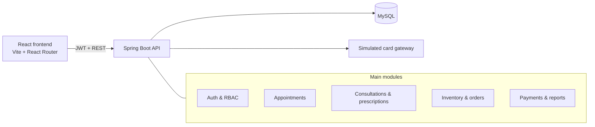

# MediSync

Pharmacy management system for patient care, consultations, prescriptions, inventory, orders, and payments.

**Stack:** Spring Boot 3 (Java 21) · MySQL · React 19 + Vite

---

## Features by role

| Role | What they can do |
|------|------------------|
| **Patient** | Register and log in, book and cancel appointments, track prescriptions, view and pay for orders, download receipts, manage profile |
| **Doctor** | View today's appointments, start consultations, write prescriptions, view their patients and issued prescriptions |
| **Pharmacist / Admin** | Manage inventory and medications, process the prescription queue (Pending → Received → Preparing → Ready for Collection → Collected), create orders, take payments, view reports, manage users, doctors, and patients, view audit log |

Key workflows:
- **Appointments** — patients book with a doctor; doctors see today's list and start a consultation.
- **Prescriptions** — doctors issue prescriptions; pharmacists advance processing status; patients track progress.
- **Orders & payments** — an order is created when a prescription moves to Preparing. Payment is required before collection. Card payments use a simulated gateway (demo mode). Only the last four digits of the card are stored.
- **Reports** — dashboard statistics, revenue report with date range, and CSV export of payments.
- **Audit log** — important actions are recorded.

---

## Prerequisites

- Java 21
- Maven (or the included `mvnw` wrapper)
- MySQL 8 running on `localhost:3306`
- Node.js 18+ and npm

---

## Quick start

### 1. Database

Create the database (or let the app create it with `createDatabaseIfNotExist=true`):

```sql
CREATE DATABASE IF NOT EXISTS pharmacy_db;
```

Default connection in `src/main/resources/application.properties` points at:

```
jdbc:mysql://localhost:3306/pharmacy_db
username: root
```

### 2. Backend

Generate a JWT secret and start the app:

**PowerShell**
```powershell
$env:JWT_SECRET = [Convert]::ToBase64String([Security.Cryptography.RandomNumberGenerator]::GetBytes(32))
./mvnw spring-boot:run
```

**bash**
```bash
export JWT_SECRET=$(openssl rand -base64 32)
./mvnw spring-boot:run
```

The API listens on **http://localhost:8090**.

Optional environment variables:

| Variable | Purpose | Default |
|----------|---------|---------|
| `JWT_SECRET` | Signing key for tokens (required) | — |
| `ADMIN_USERNAME` | Bootstrap admin username | `admin` |
| `ADMIN_EMAIL` | Bootstrap admin email | `admin@medisync.example` |
| `ADMIN_PASSWORD` | Bootstrap admin password | `Admin@12345` |
| `SMTP_HOST`, `SMTP_PORT`, `SMTP_USERNAME`, `SMTP_PASSWORD`, `SMTP_FROM` | Password-reset email | localhost / 25 |
| `FRONTEND_URL` | Base URL used in reset links | `http://localhost:5173` |

On first run the app seeds:
- An admin account (`admin` / `Admin@12345` unless overridden)
- Sample doctors and doctor logins (password: `password`)
- A sample South African medicine catalogue and stock

### 3. Frontend

```bash
cd pharmacy-frontend
cp .env.example .env
npm ci
npm run dev
```

Open **http://localhost:5173**. The app talks to the backend at the URL in `VITE_API_URL` (default `http://localhost:8090`).

---

## Demo accounts

| Role | Username | Password |
|------|----------|----------|
| Admin | `admin` | `Admin@12345` |
| Doctor | (seeded doctor logins) | `password` |
| Patient | register a new account | — |

---

## Demo card numbers (simulated gateway)

| Number | Result |
|--------|--------|
| `4242 4242 4242 4242` | Visa — approved |
| `5555 5555 5555 4444` | Mastercard — approved |
| `4000 0000 0000 0002` | Declined |
| `4000 0000 0000 9995` | Insufficient funds |
| `4000 0000 0000 0069` | Expired card |

Any 12–19 digit number is approved in demo mode. There is no funds check — the order amount is paid as-is. Use a future expiry and a 3- or 4-digit CVV. The backend never stores the full card number or CVV.

---

## Running tests

```bash
./mvnw test
```

Most tests run without a database. The full Spring context integration test is opt-in:

```bash
RUN_DB_INTEGRATION_TESTS=true ./mvnw test
```

---

## Project structure

```
pharmacy-system-medisnyc/
├── src/main/java/za/ac/cput/medisnyc/
│   ├── controller/     REST endpoints
│   ├── service/        business logic
│   ├── domain/         JPA entities
│   ├── repository/     data access
│   ├── security/       JWT + RBAC
│   ├── dto/            request/response objects
│   └── exception/      global error handling
├── pharmacy-frontend/  React + Vite app
└── pom.xml
```

---

## One-time database note

If you have an older database, widen the audit log column (Hibernate `ddl-auto=update` does not enlarge existing columns):

```sql
ALTER TABLE audit_logs MODIFY COLUMN details TEXT;
```

---


## Payments, receipts, and inventory

- Card payments are stored in the `payments` table and linked to the order (`paymentStatus`, `paymentId`, `paidAt`). Reports read from those payment records, so paid orders appear in revenue.
- On a successful payment the patient receives a notification that includes the receipt number, amount, order id, date, card brand, and last four digits.
- All inventory batches are set to expire in 2028. Existing rows are updated on startup; newly seeded batches use 2028-12-31 (first batch) and 2028-06-30 (second batch).

## Notes

- Legacy orders created before payment tracking have a null payment status and are treated as unpaid. They are excluded from revenue until paid.
- Password reset requires SMTP configuration. Without it, registration and login still work.
- This is a demonstration system. Do not use real card data.

---

---

## Architecture



Request flow: the React app stores the JWT and sends it on every API call. Spring Security validates the token, applies role rules, and the controller delegates to a service. Services own the business rules (ownership, status transitions, stock, payment checks) and talk to JPA repositories.

---

## Demo script (about 5–8 minutes)

1. **Login as admin** — `admin` / `Admin@12345`. Show the dashboard tiles (doctors, patients, inventory, reports, audit log).
2. **Register a patient** (or log in as a seeded patient). Book an appointment with a doctor.
3. **Login as a doctor** (seeded doctor password: `password`). Open today's appointments, start a consultation, save a medical record, and issue a prescription.
4. **Login as admin/pharmacist**. Open the prescription queue. Advance the prescription: Pending → Received → Preparing (order is created here) → Ready for Collection.
5. **Pay the order**. Use test card `4242 4242 4242 4242`, any future expiry, any CVV. Show the receipt. Optionally try `4000 0000 0000 0002` to show a decline message.
6. **Collect**. Advance to Collected. Show that collection is blocked if the order is still unpaid (if you demo that path).
7. **Reports**. Open reports: dashboard stats, revenue for a date range, and CSV export.
8. **Audit log**. Show the recorded actions (payment, status changes, etc.).

Suggested screenshots to add later (place them in `docs/screenshots/` and link them here):

- Login / dashboard
- Book appointment
- Consultation form
- Prescription queue
- Payment checkout and receipt
- Reports

---

## Feature review

### Payments — solid

Server-side amount (never trusts the client), ownership check for patients, idempotency key, rate limit after 5 failures in 10 minutes, card data cleared after use, only last-4 stored, receipt numbers, refunds (admin), and notifications. Failed payments return a proper error instead of a 201.

### Prescription flow — solid

Clear status machine: Pending → Received → Preparing → Ready for Collection → Collected. Order is created at Preparing, payment is required before Collected, stock is checked, expiry is handled, and the patient is notified on each step. Ownership checks exist for patient and doctor reads.

### Reports — good

Dashboard stats (patients, appointments, prescriptions, orders, low stock, awaiting collection, payments today, outstanding amount), revenue report with date range and average order value, and CSV export of payments.

### Appointments — good

Patients can only book/cancel their own; doctors and admins have the right access. Validation on the request DTO. Simple and correct.

No critical bugs in these flows. They are ready for demo.

---

## Frontend UX / error handling

Most pages already have loading and error states (`setError` + `parseApiError` + `<Alert>`). Payment checkout is particularly good — it maps decline codes to friendly messages.

| Page | Status |
|------|--------|
| PaymentCheckout, Reports, BookAppointment, ConsultationForm, OrderList, PrescriptionQueue, etc. | Good |
| Dashboard | Fine — it only renders role-based tiles, no data fetch |
| About / Contact / Home / Services | Static — no error state needed |
| ConsultationForm | Fixed — medication list load failure now shows an error message |

The previous silent medication-load failure has been fixed.

---

## Test coverage

Test classes covering factories, repositories, most services, and controllers (Consultation, Notification, PrescriptionProcessing, Payment).

**Well covered:** PaymentService, PrescriptionProcessingService, Inventory/Medication, Order, UserManagement, SimulatedCardGateway, factories, AppointmentService, PaymentController, ReportService date validation.

**Added:**

- `AppointmentServiceTest` — book, reject missing doctor/patient, cancel, invalid status transition
- `PaymentControllerTest` — patient ownership, staff payment, missing patient profile
- `ReportServiceTest` — rejects a revenue report when `from` is after `to`

**Still optional:**

- AppointmentController
- AuthController
- OrderController
- AdminController / ProfileController
